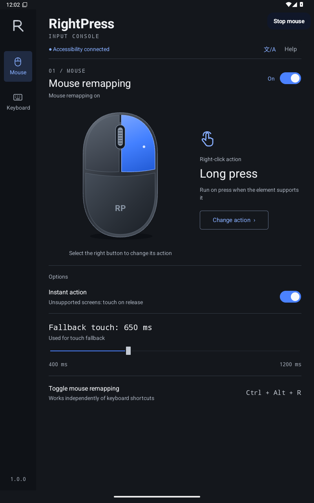
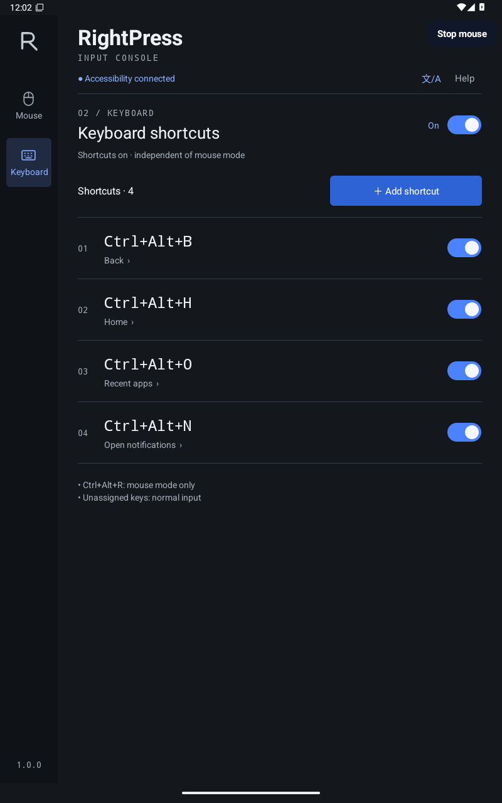

# RightPress

Mouse button actions and external-keyboard shortcuts for **Android 14+**.

**Update submitted: 1.0.3 (13).** Adjustable wheel scrolling and notification-based mouse stop. The 100% production rollout was requested on November 5, 2026 at 22:57 KST; Console shows changes in review. Publication follows Google approval and is not yet confirmed. [Submission record](docs/play-production-release.md).

**Google Play release: 1.0.2 (12).** [Install from Google Play](https://play.google.com/store/apps/details?id=io.github.doctor_clawler.rightpress). The Console records publication at 21:44 KST on November 4, 2026; the public listing offers installation without joining a test. See the [release record](docs/play-production-release.md).

**Accessibility setup update:** Adds a separate guide in all 31 locales and retains the service-entry scroll/highlight hint for supported Android settings screens. Submission 2 is published with a 100% production rollout. The Console and Korean and US public listings were rechecked on November 5, 2026.

**Earlier internal test: 0.6.1-beta.1 (9).** The [test invitation](https://play.google.com/apps/internaltest/4701300851549043962) was limited to five registered accounts and used the temporary name `io.github.doctor_clawler.rightpress (unreviewed)`.

**Latest GitHub APK beta: 0.6.0-beta.1.** [Release page](https://github.com/WithClawler/rightpress/releases/tag/v0.6.0-beta.1). Official beta APKs are attached to releases marked **Pre-release**.

[한국어](README.ko.md) · [Privacy](PRIVACY.md) · [Changelog](CHANGELOG.md) · [Languages](LOCALIZATION.md) · [Contributing](CONTRIBUTING.md)

<p>
  
  
</p>

Screenshots: 1.0.0 (10) running on the Android emulator in portrait orientation. Accessibility use requires the in-app disclosure and consent step.

## Features

- Wheel scroll amount: adjust in the Mouse tab from 10–100% of the previous swipe distance. Default 30%; changes apply immediately and are saved automatically. 100% restores the previous distance, not native mouse-wheel input.

- **Right-click actions:** long-press, Back, Home, Recents or Notifications.
- **Keyboard actions:** Back, Home, Recents, Notifications, Quick Settings, launch an app or toggle mouse conversion.
- Independent mouse and keyboard switches; individual shortcut switches.
- Local settings, no accounts, advertisements, analytics or network permission.
- Native Android interface that adapts to portrait, landscape and narrow screens.
- 30 languages / 31 locales, including Simplified and Traditional Chinese; system fonts only.
- No root, ADB or Shizuku required to use the app.

For long-press, RightPress first requests the target element's accessibility long-click action **when the mouse button is pressed**. If unsupported or rejected, it sends a touch long-press after release. Turn off `Instant action` to always use that fallback. Its duration is 400–1,200 ms, default 650 ms. Other right-click actions run on button down.

## Install

### Google Play release

1. Open the [Google Play listing](https://play.google.com/store/apps/details?id=io.github.doctor_clawler.rightpress) on Android 14 or later and install RightPress.
2. Open RightPress → `Enable accessibility service`, read the disclosure and agree if you want to use the service.
3. In Android accessibility settings, open **Installed apps** on Samsung devices, or **Downloaded apps** on other devices. Select the localized **RightPress input helper**, turn on **Use** and confirm **Allow**.
4. Return to RightPress and configure the `Mouse` and `Keyboard` tabs.

The public 1.0.2 update adds a separate guide before opening Android settings from both the main connection button and Help. It uses the service name in the selected language. Saved consent is not requested again; canceling this guide changes neither settings nor the saved consent state. Supported settings screens may scroll to or highlight the service entry. Opening its detailed switch directly is not guaranteed.

### Earlier Google Play internal test

1. Open the [test invitation](https://play.google.com/apps/internaltest/4701300851549043962) while signed in with a registered tester Google account. Access is limited to the five accounts in the existing beta list.
2. Select **Accept invite**, then follow the Google Play installation link.
3. Open RightPress → `Enable accessibility service`, read the disclosure and agree if you want to use the service.
4. Open Android accessibility settings from the app and enable **RightPress input helper**.
5. Return to RightPress and configure the `Mouse` and `Keyboard` tabs.

The earlier internal test was limited to five registered testers and was not an open beta. On November 2, 2026, version 0.6.1-beta.1 (9) was downloaded from Play, installed and opened on a Galaxy XCover 5 (SM-G525N, Android 14). The test app was then uninstalled at the user’s request. Accessibility and external mouse/keyboard operation on that device were not tested. Play installation does not automatically grant accessibility access.

A reported Play download failure on a Galaxy Tab A9 running Android 16 remains unresolved. Play showing an app as installed on the web does not verify its presence or launch on that device. The separate Android 16 emulator check installed a Play-signed APK through ADB; it did not verify a Play download or the main app screen because the Play licensing check redirected to the signed-out store.

### GitHub APK

1. Download the APK from [Releases](https://github.com/WithClawler/rightpress/releases/tag/v0.6.0-beta.1). Actions artifacts are development builds, not the signed beta.
2. Install it on Android 14 or later. Allow installation from your download app if Android asks.
3. Open RightPress → `Enable accessibility service`, read the accessibility disclosure and agree if you want to use the service.
4. Open Android accessibility settings from the app and enable **RightPress input helper**.
5. Return to RightPress and configure the `Mouse` and `Keyboard` tabs.

Android can restrict accessibility for sideloaded apps. If necessary, open Android **App info → More → Allow restricted settings**, but only for an APK whose source you trust. Menu names vary by device.

**Updating from an official GitHub beta:** the Play internal release uses the same package and app signing certificate. A signed 0.6.0→0.6.1 APK update preserved settings, shortcuts and consent in emulator tests; an actual Play update still needs device verification. The GitHub 0.6.0 APK also updates the official 0.5.0 beta in place.

**Earlier private test builds:** the beta uses package `io.github.doctor_clawler.rightpress` and a dedicated release signing key. The former `com.example.rightpress` debug app (0.4.0 or earlier) is a separate app, so this is a **new installation**, not an in-place update. Record your old settings and disable its accessibility service first. Both apps can remain installed, but enable only one RightPress service at a time. Settings do not migrate automatically; recreate them in the beta. Locally built debug APKs also cannot update official beta APKs because their signatures differ.

## Language

[Language picker screenshot](docs/images/languages.png)

Tap **文/A** in the header and select a language by its native name, or choose **System default**. Android’s per-app language settings control the same preference. English is the fallback when no supported language matches. Changing the language preserves shortcut bindings and input settings.

The 30-language selection covers major mobile and internet markets; it is not a measured ranking of RightPress users. These are initial beta translations without native-speaker review. Report wording issues with the language, screen and suggested correction.

Text uses Android’s system fonts and fallback glyphs. No font files, downloads or localization SDK are added. Translations add text resources, so APK size can increase. See [language coverage and contribution steps](LOCALIZATION.md).

## Shortcuts and stopping

| Default shortcut | Action |
| --- | --- |
| `Ctrl+Alt+B` | Back |
| `Ctrl+Alt+H` | Home |
| `Ctrl+Alt+O` | Recents |
| `Ctrl+Alt+N` | Notifications |
| `Ctrl+Alt+R` | Toggle mouse conversion; fixed, cannot be reassigned |

Add a rule with `Keyboard → ＋ Add shortcut → Record key combination`, press Ctrl or Alt with another key, choose an action and save. Shift is optional. Esc cancels recording. Duplicate combinations, including disabled rules, are rejected. Meta/Windows, Sym and Fn combinations are not supported.

- Stop mouse conversion: `Ctrl+Alt+R`, the `Stop mouse` notification action or the mouse switch. The app asks once for notification permission while mouse conversion is active. If declined, use the shortcut or app switch; no floating stop button is shown.
- Stop configurable shortcuts: turn off `Keyboard shortcuts`. The fixed `Ctrl+Alt+R` toggle remains available.
- Stop all input handling and withdraw access: disable the service in Android accessibility settings.

The accessibility service must remain enabled to handle input while you use other apps. Closing the settings screen does not stop it, and you do not need to keep the display on. On/off choices are saved. Android manages service startup and reconnection; after a restart or system restriction, check the service state in RightPress and Android accessibility settings. Uninterrupted background operation and battery impact have not been verified on every device.

## Compatibility and verification scope

Mouse conversion uses a full-screen transparent accessibility overlay. Left clicks and drags are relayed as touch taps and swipes; the wheel becomes touch scrolling. Hover, precise dragging, text selection and multitouch can differ from normal mouse behavior. Turn off mouse conversion when those differences are disruptive; keyboard shortcuts can stay enabled.

- Immediate long-press depends on the target app. If it reports success without a visible result, turn off `Instant action` and try the release-based fallback.
- System/security dialogs, games, device policies and reserved key combinations can restrict actions.
- App-launch shortcuts support launchable apps visible to RightPress.
- No key-to-key remapping, text expansion, macros or per-app profiles.
- Physical tablets, Bluetooth/USB input devices, Samsung DeX, split screen, external displays and battery impact still need testing. Individual third-party apps are not guaranteed compatible.
- Emulator checks, GitHub beta releases and internal-test availability do not establish standard Google Play approval.

For private support, email support@mibstudio.top. Report reproducible problems through [GitHub Issues](https://github.com/WithClawler/rightpress/issues). Include app/Android version, device and input-device models, connection type, screen orientation and steps. Issues are public: remove personal content, credentials and private screenshots. For vulnerabilities, see [SECURITY.md](SECURITY.md).

## Privacy and accessibility

The service receives input events to match shortcuts and inspects the screen's accessibility hierarchy to locate elements and invoke actions. It does not read element text or save typing history, screen content or screenshots. Saved rules, selected app identifiers, settings and consent state remain on the device. Android stores the app-language preference locally. There is no `INTERNET` permission or analytics SDK. See the full [privacy notice](PRIVACY.md).

## Build and test

Requirements: JDK 17, Android SDK Platform 36, Build Tools 35.0.0 and Python 3 for translation checks. Configure `ANDROID_HOME`, or set `sdk.dir` in an untracked `local.properties` file. The app still runs on Android 14 and later (minSdk 34).

```sh
python3 tools/localization.py check
./gradlew :app:assembleDebug :app:lintDebug :app:assembleDebugAndroidTest
```

The included Gradle 8.11.1 wrapper verifies its distribution SHA-256; Android Gradle Plugin is 8.10.1. Output: `app/build/outputs/apk/debug/app-debug.apk`. Debug builds use a local debug key and do not update the signed public beta. Release signing keys are not in this repository or GitHub Actions.

To build a release APK with **your own** signing key, provide these environment variables through your local secret-management setup, then run `./gradlew :app:assembleRelease`:

- `RIGHTPRESS_SIGNING_STORE_FILE`
- `RIGHTPRESS_SIGNING_STORE_PASSWORD`
- `RIGHTPRESS_SIGNING_KEY_ALIAS`
- `RIGHTPRESS_SIGNING_KEY_PASSWORD`

The `assembleRelease` command fails if signing credentials are missing. Output: `app/build/outputs/apk/release/app-release.apk`. Your signature does not match the official beta signature; keep your key private and retain it for your own future updates.

With the same signing environment, `./gradlew :app:bundleRelease` creates `app/build/outputs/bundle/release/app-release.aab` for a store upload. Language splitting is disabled so all supported languages remain available offline. An AAB build alone does not publish an app or create a tester link. See [Google Play test delivery](docs/google-play-testing.md) for release and signing checks.

**GitHub Actions:** pushes, pull requests and manual runs check translation coverage and format arguments, build the debug app, run lint and compile instrumentation tests. Download the `RightPress-debug-build` artifact. CI does not execute the device tests.

Device tests are in `app/src/androidTest`. Some inject physical key events through an emulator-only `evdev` helper and require a disposable AOSP emulator with root-capable test access; they are not safe as a generic physical-device test command. The helper is excluded from the app APK, and the app itself does not require root. See [CONTRIBUTING.md](CONTRIBUTING.md).

## License

Original RightPress code and artwork: [MIT](LICENSE). Gradle wrapper files retain their upstream license; see [third-party notices](THIRD_PARTY_NOTICES.md).

The trigger-to-action setup flow was informed by Key Mapper's public documentation. RightPress has its own implementation and visual assets; no Key Mapper source or artwork is included.

## 공통 웹 빌드 주소

웹 빌드·미리보기의 공통 계약은 [웹 배포](../_ops/docs/local-web-deployment.md)와 [내부 DNS](../_ops/docs/internal-dns.md)를 따른다. 완료 주소는 대표 `http://<channel>.home.arpa/`, 변형 `http://rightpress.<variation>.home.arpa/`이며 포트를 붙이지 않는다. 채널명은 소문자로 바꾸고 `_`는 `-`로 정규화하며 기존 짧은 별칭은 호환 주소로 보존한다.

백엔드는 `env.dev.local`과 중앙 allocator를 사용해 LAN에 bind하고, 소유 listener·LAN HTTP·대표/변형 주소의 이번 빌드를 확인한 뒤 요청 thread에 결과를 반환한다. 프로젝트 고유 빌드·데이터 보존·배포 gate는 유지한다. 웹 미지원 프로젝트에 이 지침만으로 새 웹 지원이나 상시 서비스를 추가하지 않는다.
